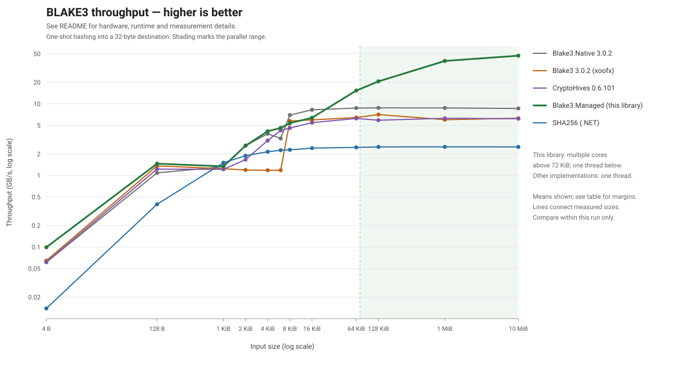
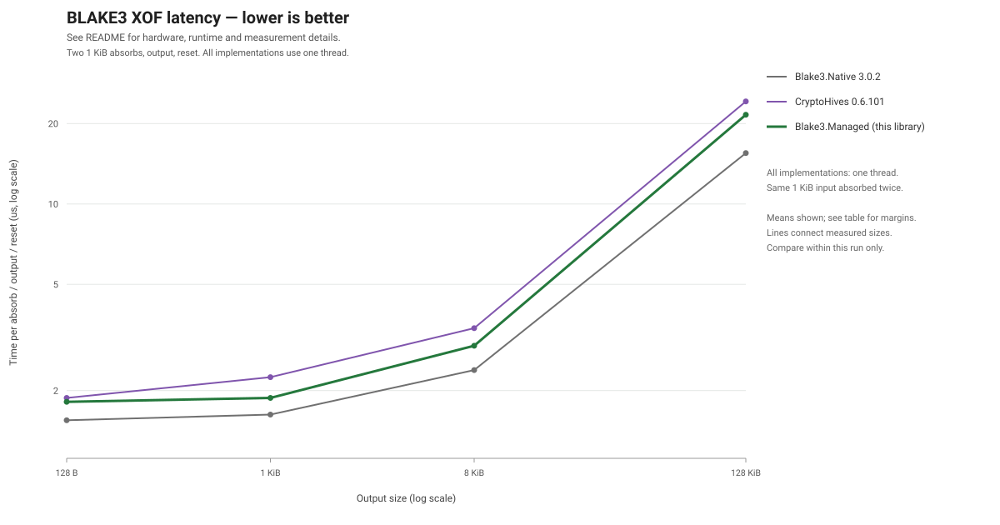

# Blake3.Managed: BLAKE3 hash function for .NET

A managed C# implementation of the [BLAKE3](https://github.com/BLAKE3-team/BLAKE3) hash function for .NET, with no native dependencies.

One managed DLL, no P/Invoke and no per-platform assets. Use it if you want BLAKE3 without shipping a native library, or if you hash large inputs: its default one-shot `Hash()` spreads large inputs across the thread pool, which the other .NET packages only do through an explicit `UpdateWithJoin` call. On a single x86 thread it is in the same range as the Rust binding, sometimes ahead and sometimes behind; on ARM64 with SVE2 (Arm Neoverse V2) its one-shot `Hash()` beat the Rust binding at every size measured. If you hash many tiny inputs through the incremental `Hasher` API, or you need an implementation someone else has audited, use [`Blake3.Native`](https://www.nuget.org/packages/Blake3.Native) instead.

[](https://www.nuget.org/packages/Blake3.Managed)
[](https://www.nuget.org/packages/Blake3.Managed)
[](https://github.com/Dissimilis/Blake3.Managed/actions/workflows/ci.yml)
[](LICENSE)
[](https://buymeacoffee.com/dissimilis)

## Features

- **Hardware accelerated** - on x86, AVX-512 16-way and AVX2 8-way parallel hashing with SSE/SSSE3 below them; on ARM64, SVE2 (Armv9, e.g. Arm Neoverse V2 or Cortex-A510) and NEON 4-way parallel hashing; automatic scalar fallback
- **Multi-threaded** - large inputs are split into subtrees and hashed on the thread pool. One-shot `Hash()` fans out from ~32 KiB, and backs off to a single thread when many hashes are already in flight; `UpdateWithJoin`, used by `Blake3HashAlgorithm` and `Blake3Stream`, fans out from ~32 KiB too on AVX2 hardware, under the same back-off. Cortex-A510 tuning also enables ARM64 `UpdateWithJoin` fan-out with a one-caller limit
- **Split hashing** - hash pieces independently and combine them into the whole-input digest with `Blake3SubtreeContext`
- **Zero allocation** for small inputs with `Hasher.Hash()`
- **All BLAKE3 modes** - default hashing, keyed hashing, and key derivation
- **XOF support** - extendable output with a seekable byte stream, producing long output 16 blocks at a time with AVX-512, 8 with AVX2 or SVE2, or 4 with SVE2 when Cortex-A510 tuning is enabled
- **Familiar API** - modeled after [Blake3.NET](https://github.com/xoofx/Blake3.NET)
- **Targets** `net6.0`, `net8.0` and `net10.0`, with Native AOT support on `net8.0` and above

## Other BLAKE3 packages

[Blake3.NET](https://github.com/xoofx/Blake3.NET) by Alexandre Mutel ships two packages in 3.x: [`Blake3`](https://www.nuget.org/packages/Blake3), a managed SIMD implementation, and [`Blake3.Native`](https://www.nuget.org/packages/Blake3.Native), a binding to the Rust implementation.

Both hash on one thread unless you call `UpdateWithJoin` explicitly; here the plain `Hash()` also uses multiple cores for large inputs. It targets .NET 6 as well as 8 and 10. If your application already hashes many inputs in parallel, set `Hasher.MaxDegreeOfParallelism` so the two layers do not compete.

The [benchmarks below](#performance) compare these packages, CryptoHives and SHA256, with separate results for one-shot hashing and extended output.

## Correctness

BLAKE3 has one right answer. CI runs the official test vectors for all three modes. A differential suite against the reference Rust implementation runs before every benchmark session, covering chunk and block boundaries, incremental splits, unaligned spans and extended output at arbitrary offsets.

It has not had an independent security audit. If that matters to you, use a binding to the reference implementation.

## Installation

```bash
dotnet add package Blake3.Managed
```

## Quick Start

```csharp
using Blake3.Managed;

// One-shot hash
var hash = Hasher.Hash("Hello, World!"u8);
Console.WriteLine(hash); // 288a86a79f20a3d6dccdca7713beaed178798296bdfa7913fa2a62d9727bf8f8

// Incremental hashing
using var hasher = Hasher.New();
hasher.Update("Hello, "u8);
hasher.Update("World!"u8);
var result = hasher.Finalize();
```

## Usage examples

### Keyed hashing and key derivation

```csharp
// Keyed hash of an input you already hold, in one call
byte[] key = new byte[32]; // your key here
var mac = Hasher.HashKeyed(key, data);

// Keyed hash, incrementally
using var keyedHasher = Hasher.NewKeyed(key);
keyedHasher.Update(data);
var sameMac = keyedHasher.Finalize();

// Key derivation
using var kdf = Hasher.NewDeriveKey("my-session-key");
kdf.Update(inputKeyMaterial);
var derivedKey = kdf.Finalize();
```

### Extended output

```csharp
using var xof = Hasher.New();
xof.Update(data);

var extendedOutput = new byte[1024];
xof.Finalize(extendedOutput);          // arbitrary length output

var later = new byte[64];
xof.Finalize(1_000_000, later);        // read from any offset in the output stream
```

### Parallel hashing

```csharp
using var parallel = Hasher.New();
parallel.UpdateWithJoin(largeData); // uses thread pool from ~32 KiB
var parallelHash = parallel.Finalize();
```

For one-shot `Hasher.Hash`, the thread limit is process-wide and does not affect `UpdateWithJoin`:

```csharp
Hasher.MaxDegreeOfParallelism = 4;  // use at most 4 threads
Hasher.MaxDegreeOfParallelism = 1;  // run on the calling thread
Hasher.MaxDegreeOfParallelism = -1; // restore the default
```

### Streams and `HashAlgorithm`

`Blake3Stream` hashes data as it passes through, so you can hash a file while copying it:

```csharp
using var source = File.OpenRead(path);
using var hashing = new Blake3Stream(source);
await hashing.CopyToAsync(destination);
var hash = hashing.ComputeHash();
```

`Blake3HashAlgorithm` plugs into anything that takes a `System.Security.Cryptography.HashAlgorithm`:

```csharp
using var algorithm = new Blake3HashAlgorithm();
byte[] digest = algorithm.ComputeHash(stream);
```

Both use `UpdateWithJoin`, so large inputs are hashed on multiple cores where AVX2 is available; elsewhere they fall back to a single thread.

### Hashing independent pieces

`Blake3SubtreeContext` combines independently hashed pieces into the whole-input digest. `ReadPiece` below represents your own file-reading code.

```csharp
using var ctx = Blake3SubtreeContext.Create(pieceSize: 1024 * 1024, totalLength: file.Length);
var pieces = new Blake3Subtree[ctx.PieceCount];
Parallel.For(0, ctx.PieceCount, i =>
{
    var piece = ReadPiece(file, ctx.GetPieceOffset(i), ctx.GetPieceLength(i));
    pieces[i] = ctx.HashSubtree(piece, i);
});
var fileHash = ctx.Finalize(pieces); // equals Hasher.Hash(wholeFile)
```

A piece can also be fed incrementally, without keeping it all in memory. This supports pieces larger than 2 GB:

```csharp
using var pieceHasher = ctx.CreateSubtreeHasher(pieceIndex);
while ((n = await stream.ReadAsync(buffer)) > 0)
    pieceHasher.Update(buffer.AsSpan(0, n));
pieces[pieceIndex] = pieceHasher.Finish();
```

`CreateKeyed` and `CreateDeriveKey` give the same split hashing in the keyed and key-derivation modes.

## Threading and lifetime

`Hasher.Hash` and `Hasher.HashKeyed` are static and safe to call from any number of threads at once. A single `Hasher`, `Blake3Stream` or `Blake3HashAlgorithm` instance is not thread-safe; use one per thread. `Blake3SubtreeContext` is the exception: it exists to be shared, and its pieces can be hashed concurrently and in any order.

`Hasher` is a mutable struct, so copying one copies its state. Pass it by `ref`, and do not store it in a field, a collection or a lambda unless you mean to fork it. `Dispose` zeroes the key material, which matters for keyed and derive-key hashers; the static one-shots need no disposal.

## Public API

| Type | Description |
|------|-------------|
| `Hasher` | Main hasher struct. Factory methods: `New()`, `NewKeyed()`, `NewDeriveKey()`, each also as an `out` overload (`Hasher.New(out var hasher)`) that builds the ~1.9 KB state in place instead of copying it -- noticeably faster for short incremental inputs; dispose that one with `try`/`finally`, since `using (hasher)` would dispose a copy. Static `Hash()` and `HashKeyed()` for one-shot hashing. Incremental via `Update()`/`UpdateWithJoin()`/`Finalize()`. Static `MaxDegreeOfParallelism` caps the fan-out used by `Hash()` and `HashKeyed()`. |
| `Hash` | Fixed 32-byte output struct with constant-time equality and allocation-free `ToString()`. |
| `Blake3Stream` | Stream wrapper that hashes data as it flows through. |
| `Blake3HashAlgorithm` | `System.Security.Cryptography.HashAlgorithm` adapter for interop with existing APIs. |
| `Blake3SubtreeContext` | Hashes fixed-size pieces of one input independently, on any threads and in any order, and folds them into the whole-input digest (32 bytes or XOF). Piece size must be a power-of-two multiple of 1024, unless the known total length fits in a single piece, in which case any size works; it is a `long`, so pieces larger than 2 GB are allowed. |
| `Blake3SubtreeHasher` | Hashes one piece incrementally through `Update` calls and `Finish`, for pieces that arrive in parts or are too large for one span. Created by `Blake3SubtreeContext.CreateSubtreeHasher`. |
| `Blake3Subtree` | Opaque result of hashing one piece, stored at its piece index and passed to `Finalize`. |

## Performance

Above ~32 KiB this library's `Hash()` uses multiple cores while the other columns run on one, so the large-input rows below are a core-count difference rather than a per-core one. Per core on x86 it lands within roughly 20% of the Rust binding either way, depending on size. The incremental API adds a fixed cost of about 100-125 ns per `Hasher` over the one-shot, which the Rust binding largely avoids, so for inputs of a few hundred bytes or less prefer `Hasher.Hash`.

### Benchmark environment

Measured on **2026-09-24** on the same Linux benchmark host as the 2026-09-21 tables this
replaced, after the AVX-512 kernels and the faster incremental and XOF paths landed.

```text
BenchmarkDotNet 0.15.8, Fedora Linux 44
AMD Ryzen 7 8845HS, 8 physical cores / 16 logical threads
.NET SDK 10.0.111, .NET 10.0.11, X64 RyuJIT with AVX-512 available
Report job: 1 launch, 3 warmup iterations, 5 measured iterations
```

Tables show **mean time ± the 99.9% confidence margin**, with lower times being
better. Each table and chart comes from the same run for that workload. Cases
run sequentially, so clock and thermal changes can affect comparisons; a lower
mean with overlapping intervals is inconclusive. Every session first passed
7,492 correctness checks against official vectors and the Rust implementation.

### One-shot hashing

All BLAKE3 implementations write into a caller-provided 32-byte destination.
This library uses `Hasher.Hash(input, output)`. CryptoHives uses a reused
instance's `TryHashOneShot` with its default SIMD selection; the package reports
SSSE3, AVX2 and AVX-512 support on this machine. SHA256 is a different algorithm,
provided as a reference.

From **64 KiB** upward in this run, this library used multiple cores and the other columns
used one thread, so those rows compare latency at different core counts. KiB and MiB denote
powers of 1,024; the chart's GB/s is decimal.

| Input | Blake3.Native 3.0.2 | Blake3 3.0.2 (xoofx) | CryptoHives 0.6.101 | Blake3.Managed (this library) | SHA256 (.NET) |
|---:|---:|---:|---:|---:|---:|
| 4 B | 59.23 ± 0.13 ns | 61.91 ± 0.08 ns | 64.55 ± 0.11 ns | 40.15 ± 0.05 ns | 284.11 ± 0.37 ns |
| 128 B | 117.65 ± 0.45 ns | 94.23 ± 0.25 ns | 104.48 ± 0.26 ns | 87.79 ± 0.07 ns | 321.88 ± 4.43 ns |
| 1 KiB | 768.46 ± 10.77 ns | 824.63 ± 1.14 ns | 842.67 ± 0.60 ns | 764.45 ± 0.67 ns | 742.31 ± 1.07 ns |
| 2 KiB | 782.29 ± 0.84 ns | 1719.54 ± 1.46 ns | 1226.47 ± 12.26 ns | 784.48 ± 0.55 ns | 1085.15 ± 3.00 ns |
| 4 KiB | 1.07 ± 0.00 us | 3.46 ± 0.00 us | 1.33 ± 0.00 us | 0.99 ± 0.00 us | 1.90 ± 0.00 us |
| 6 KiB | 1.88 ± 0.00 us | 5.19 ± 0.01 us | 1.44 ± 0.00 us | 1.35 ± 0.00 us | 2.73 ± 0.00 us |
| 8 KiB | 1.17 ± 0.00 us | 1.42 ± 0.00 us | 1.56 ± 0.00 us | 1.38 ± 0.00 us | 3.54 ± 0.01 us |
| 16 KiB | 1.95 ± 0.00 us | 2.51 ± 0.00 us | 2.98 ± 0.01 us | 2.05 ± 0.00 us | 6.88 ± 0.01 us |
| 64 KiB | 7.52 ± 0.02 us | 9.35 ± 0.01 us | 10.36 ± 0.05 us | 3.23 ± 0.07 us | 26.65 ± 0.02 us |
| 128 KiB | 14.88 ± 0.01 us | 18.58 ± 0.02 us | 21.38 ± 0.26 us | 5.15 ± 0.18 us | 52.56 ± 0.04 us |
| 1 MiB | 119.50 ± 0.18 us | 163.32 ± 0.36 us | 154.92 ± 6.47 us | 21.85 ± 0.09 us | 417.26 ± 0.21 us |
| 10 MiB | 1.22 ± 0.00 ms | 1.69 ± 0.01 ms | 1.54 ± 0.00 ms | 0.18 ± 0.00 ms | 4.19 ± 0.00 ms |



Of the single-threaded sizes in this run, this library is fastest at 4 B, 128 B, 4 KiB and
6 KiB, level with native at 1 KiB and 2 KiB (within 0.5%), and native is fastest at 8 KiB and
16 KiB, by 18% and 5%.

### Extended output (XOF)

Each operation absorbs the **same 1 KiB block twice**, emits the indicated
output length, then resets a reused hasher. All three implementations use one
thread. The chart measures the complete operation: absorption, output and reset.

| Output | Blake3.Native 3.0.2 | CryptoHives 0.6.101 | Blake3.Managed (this library) |
|---:|---:|---:|---:|
| 128 B | 1.55 ± 0.00 us | 1.88 ± 0.00 us | 1.76 ± 0.00 us |
| 1 KiB | 1.62 ± 0.00 us | 2.24 ± 0.00 us | 1.82 ± 0.00 us |
| 8 KiB | 2.38 ± 0.00 us | 3.43 ± 0.00 us | 2.58 ± 0.00 us |
| 128 KiB | 15.52 ± 0.04 us | 23.69 ± 0.02 us | 16.30 ± 0.10 us |



Native is fastest at every output length here, by 5% at 128 KiB of output and 13% at
128 B; this library is ahead of CryptoHives throughout. The XOF numbers come from a separate
run on the same machine.

### ARM64 with SVE2 (Arm Neoverse V2)

Measured on **2026-09-23** on Arm Neoverse V2 (128-bit SVE2),
2 cores, Ubuntu 26.04, .NET 10.0.12, BenchmarkDotNet default job. Mean times, single-threaded
except where marked:

| Input | Blake3.Native 3.0.2 | Blake3.Managed `Hash(input, output)` | Blake3.Managed `Update` + `Finalize` |
|---:|---:|---:|---:|
| 4 B | 102.2 ns | 88.1 ns | 209.8 ns |
| 128 B | 188.0 ns | 166.1 ns | 285.6 ns |
| 1 KiB | 1.35 us | 1.30 us | 1.43 us |
| 2 KiB | 2.77 us | 2.11 us | 2.89 us |
| 4 KiB | 2.92 us | 2.30 us | 2.45 us |
| 16 KiB | 11.40 us | 7.06 us | 8.59 us |
| 64 KiB | 45.37 us | 15.70 us (2 cores) | 30.01 us |
| 1 MiB | 726.1 us | 232.1 us (2 cores) | 459.2 us |

The one-shot hash is faster than the Rust binding at every size here. The incremental API is
faster from 4 KiB; below that, creating and finishing a `Hasher` costs more than it does in Rust,
because the hasher is a roughly 2 KB struct that .NET zeroes and copies. Extended output is well
ahead on this machine: in a separate in-process comparison, 64 KiB of output took 0.28 of the
Rust binding's time, because the Rust crate produces ARM output one block at a time.

### Cortex-A510 tuning

SVE2 instruction scheduling, three-parent batching and a specialized partial-chunk
kernel are enabled by default. Applications running on Cortex-A510 can also select
CPU-specific batching before the first call to this library:

```csharp
AppContext.SetSwitch("Blake3.Managed.TuneForCortexA510", true);
```

This switch is off by default and read once. Enable it only when the application runs
on Cortex-A510 cores; it does not detect the CPU model or change thread affinity.
It selects two four-chunk SVE2 calls for eight-chunk batches, four-block SVE2 XOF
output, scalar handling of short NEON tails, and ARM64 `UpdateWithJoin` fan-out.
The NEON choices also apply when SVE2 is unavailable to the runtime. Other CPU models
retain the default batching policy, including eight-block SVE2 XOF output.

With tuning enabled, ARM64 `UpdateWithJoin` can use multiple cores above 32 KiB
when the current chunk state and available subtrees permit it. Only the first eligible
caller may fan out; later eligible calls use the serial path until contention subsides.
This gate does not count every ordinary ARM64 `Hash` call. As with the existing x86
Join path, `Hasher.MaxDegreeOfParallelism` controls one-shot hashing only.

The combined implementation was compared with **v1.9.0** on **2026-10-14**, using four
Arm Cortex-A510 cores with 128-bit SVE2 and the performance governor. Selected
.NET 10.0.12 results follow; lower times are better. Hash rows write a 32-byte digest.
XOF rows create a hasher, absorb 64 bytes, generate output, and dispose it.

| Workload | v1.9.0 | New defaults | Cortex-A510 tuning |
|---|---:|---:|---:|
| Hash, 4 KiB input | 14.69 us | 5.91 us | 5.99 us |
| Hash, 8 KiB input | 30.09 us | 18.92 us | 11.05 us |
| XOF, 128 B output (control) | 1.068 us | 1.070 us | 1.073 us |
| XOF, 256 B output | 2.424 us | 1.838 us | 1.133 us |
| XOF, 512 B output | 2.403 us | 1.827 us | 1.484 us |
| XOF, 4096 B output | 13.83 us | 9.23 us | 6.51 us |

These are steady-state medians of process medians: three fresh processes per build,
five timed samples per process, one second of warmup, and reversed execution order
between rounds. These single-threaded cases were pinned to one core. They do not
measure startup or JIT cost. The 32-byte hash control also stayed within 1% of v1.9.0.

For 8 MiB `UpdateWithJoin` calls on .NET 10, tuning raised single-caller throughput
from 266 to 2263 MB/s by using four cores instead of the previous serial path.
With four concurrent callers, aggregate throughput rose from 885 to 2392 MB/s.
These compare the complete implementation with v1.9.0, including the faster kernels;
they do not isolate the benefit of threading. MB/s is decimal.

The integration passed 589 tests in each of 12 ARM configurations: .NET 10.0.12 and
.NET 11 RC1 (`11.0.0-rc.1.26425.128`), SVE2/NEON/scalar, and tuning off/on. Each
configuration also passed 7,492 official-vector and Rust-reference checks. Guarded
memory tests passed for the new partial-chunk and four-block XOF kernels on both
runtimes. The Neoverse V2 table above remains an earlier comparison with the Rust
binding; Cortex-A510 gains should not be assumed for other CPU models.

### Reproducing the results

The commands below reproduce the competitive benchmark workloads above. The
Cortex-A510 comparisons used separate baseline and candidate builds with a paired measurement harness.

```bash
# One-shot table: 5 implementations, 12 input sizes
dotnet run --project src/Blake3.Managed.Benchmarks -c Release -- --competitive --report --filter '*Native*' '*Xoofx*' '*CryptoHives*' '*OursSpan*' '*Sha256*'

# XOF table: 3 implementations, 4 output sizes
dotnet run --project src/Blake3.Managed.Benchmarks -c Release -- --xof --report --filter '*AfterXof*' '*NativeXof*' '*CryptoHivesXof*'

# Regenerate the charts from a BenchmarkDotNet CSV export (Python, no dependencies)
python src/Blake3.Managed.Benchmarks/make_chart.py <oneshot-report.csv> img/benchmark.svg --context "<CPU> · <.NET version> · <date>"
python src/Blake3.Managed.Benchmarks/make_chart.py <xof-report.csv> img/benchmark-xof.svg --xof --context "<CPU> · <.NET version> · <date>"
```

The generator also accepts a BenchmarkDotNet console log. Use `--table table.md`
and `--data results.csv` to produce matching Markdown and chart data from a new
run.

### Hardware Intrinsics Tiering

The implementation automatically selects the best available instruction set at runtime:

| Tier | Instructions | Parallelism |
|------|-------------|-------------|
| **AVX-512** (.NET 8+) | 512-bit vectors | 16-chunk batches for whole 16-chunk subtrees and 16-block XOF output; everything smaller uses the AVX2 tier with AVX-512 VL rotates |
| **AVX2** | 256-bit vectors | 8-chunk batches, partial batches for 5–7 chunks, a 3–4 chunk kernel where AVX-512 VL is present, 2-chunk remainders, 8-way parent hashing and 8-block XOF output |
| **SSE/SSSE3** | 128-bit vectors + shuffle | 4 chunks simultaneously, single-lane SIMD fallback |
| **ARM SVE2** (.NET 10) | 128-bit SVE vectors with `XAR` (fused xor and rotate) | 8 chunks as two interleaved 4-lane batches, 4-chunk batches, 2- and 3-chunk remainders, 4-way parent hashing (plus three-parent remainders) and 8-block XOF output; Cortex-A510 tuning selects two 4-chunk calls and 4-block XOF output |
| **ARM NEON** | 128-bit vectors | 4 chunks simultaneously, 3-chunk remainders, 4-way parent hashing |
| **Scalar** | Pure C# | Single blocks on ARM64, and the portable fallback everywhere else |

SVE2 uses the `System.Runtime.Intrinsics.Arm.Sve2` API, which .NET 10 marks experimental; the
library only reads `Sve2.IsSupported` and `Sve2.XorRotateRight`, and on CPUs without SVE2 the
NEON path runs unchanged. The NEON path is tested on Arm Neoverse V1, which has SVE
but not SVE2 and so takes it.

## Building from Source

```bash
# Requires .NET 10 SDK
dotnet build Blake3.Managed.sln -c Release

# Run tests
dotnet test src/Blake3.Managed.Tests -c Release

# Run benchmarks
dotnet run --project src/Blake3.Managed.Benchmarks -c Release

# Create NuGet package
dotnet pack src/Blake3.Managed -c Release
```

## Acknowledgments

- [Blake3.NET](https://github.com/xoofx/Blake3.NET) by Alexandre Mutel, for API design and test infrastructure
- [Blake2Fast](https://github.com/saucecontrol/Blake2Fast) by Clinton Ingram, for the shuffle-based SSE message permutation
- [BLAKE3 Reference Implementation](https://github.com/BLAKE3-team/BLAKE3), for the algorithm specification and test vectors
